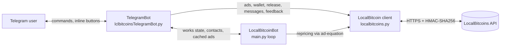

# localbits

A Python trading assistant for the LocalBitcoins.com P2P exchange. It repriced my buy and sell ads against competitors, handled incoming trades, and let me control everything from a Telegram bot.

> [!NOTE]
> **This project is archived and kept for reference only.** LocalBitcoins shut down in 2023, so its API is gone and this code no longer runs against a live service. It was written between 2019 and 2021 as a personal tool, and the git history covers September 2020 to July 2021. Nothing here is maintained.

---

## What it did

The bot ran one long-lived loop alongside a Telegram bot. It had three independent "works" that could be switched on and off at runtime.

| Work | What it did |
|------|-------------|
| **Sell** | Watched the public "buy bitcoins online" listing for Sberbank (RUB) and undercut by 2 RUB the first suitable competitor priced above a configurable **sell border**. Also managed the trades opened on my sell ad (see below). |
| **Buy** | Worked out a target buy price from the current seller prices (mean + standard deviation of the top 3, minus a configurable **buy difference**, and at least 40,000 RUB below the cheapest seller). If a competing buyer's ad was priced below that target, it outbid them by 2 RUB. |
| **Scan** | Compared the average buyer and seller prices and printed the spread. It played a Windows system sound when the spread was over 120,000 RUB. This work is on by default. |

**Trade (contact) handling for the sell ad:**

1. It polled the seller dashboard for open, non-disputed trades.
2. When a new trade appeared, it posted the active payment-card message to the buyer automatically.
3. It forwarded new buyer messages to Telegram with **Release** and **Message** buttons.
4. When the buyer marked the trade as paid without having written anything, it asked them for their initials.
5. It sent a "Payment completed" notification. One tap released the escrow.
6. After a release, it offered one-tap feedback (trust / positive / neutral / block) with preset comments or no comment.

**Ad and wallet management from Telegram:** turning ads on and off, editing ad min/max limits, and viewing the wallet balance and receiving address.

## How it works



- **`LocalBitcoin`** (`localbitcoins.py`) is a class that wraps the REST API. It handles request signing, retries and throttling.
- **`TelegramBot`** (`lclbitcoinsTelegramBot.py`) is built on `python-telegram-bot`. It registers the commands, the inline-keyboard menu (a `ConversationHandler`), and the callbacks for releasing trades, messaging and feedback. It also holds the shared runtime state:
  - `worksDictionary` holds the on/off state of each work and its parameters (sell border, buy difference, active card).
  - `contactsDictionary` tracks the open trades.
  - `recentAdsDictionary` caches the public ad listings for about 10 seconds, so the works don't fetch the same data twice.
- **`LocalBitcoinBot`** (`main.py`) holds the pricing logic (`selling`, `buying`, `scanning`). Its `__main__` block:
  1. starts Telegram polling;
  2. loads the trades that are already open, without re-messaging their buyers;
  3. loops forever over the works that are switched on.

  If a JSON decode error occurs, it waits 10 seconds and restarts the loop. Any other exception is sent to the Telegram chat as an error message, and the loop restarts after 5 seconds.

Ad filtering was hard-coded for the author's use case: Sberbank and RUB only, plus fixed min/max amount windows and a small ignore list of usernames.

## Telegram commands

These are the commands registered in `TelegramBot.__init__`.

| Command | Arguments | Description |
|---------|-----------|-------------|
| `/start` | – | Greeting with a link to the author's LocalBitcoins profile. |
| `/help` | – | Short usage text. |
| `/menu` | – | Opens the inline menu with three sections: **Ads**, **Works** and **Wallet** (see below). |
| `/adsstatus` | – | Shows the status of the buy and sell ads (on/off, limits), the current sell border, buy difference and active card, and the BTC balance. |
| `/switchad` | `sell\|buy` `on\|off` (or `1\|0`) | Turns the chosen ad on or off. |
| `/switchwork` | `sell\|buy\|scan` `on\|off` [number] [card] | Starts or stops a work. `sell` takes a sell-border number and a card keyword (one per configured payment card). `buy` requires a buy-difference number. Switching `sell` or `buy` also toggles the matching ad. |
| `/changeborder` | `sell\|buy` `<±number>` | Adds the number to the current sell border or buy difference. |

Example: `/switchwork sell on 2500000 me`

> The `/help` text also mentions `/changeAdPrice` and `/changeWorkMode`, but no handlers exist for them. `changeAdPrice` is an unfinished stub.

**The `/menu` sections:**

- **Ads** shows both of my ads: bank and type, an on/off toggle, the current price equation, and min/max limit buttons. Tapping a limit asks you to type a new value (or tap `Отмена`, "Cancel"). The new value is saved to the ad.
- **Works** has Selling, Buying and Scanning panels. Each panel has an on/off toggle. The Selling and Buying panels add ±2k / ±10k buttons and manual entry for the sell border or buy difference. The Selling panel also has a selector for the active payment card.
- **Wallet** shows the total balance, the sendable amount and the BTC receiving address.

**Trade notifications** have inline buttons for these actions:

- **Release** releases the escrow.
- **Message** sends a text reply to the buyer.
- **Feedback** buttons (😁 / 😃 / 😐 / 🚫) leave feedback on the buyer.
- **Menu** jumps back to the main menu.

## API client details (`localbitcoins.py`)

- **Base URL:** `https://localbitcoins.fi`. This domain is hard-coded in the client.
- **Authentication:** LocalBitcoins HMAC authentication. Each request sends three headers:
  - `Apiauth-Key`: the HMAC key;
  - `Apiauth-Nonce`: the current time in milliseconds;
  - `Apiauth-Signature`: the uppercase hex HMAC-SHA256 of `nonce + key + endpoint + urlencoded_params`, signed with the HMAC secret.
- **Transport:** GET and POST requests through `requests`.
  - GET returns the `data` field of the JSON response.
  - POST returns a `(status_code, response_text)` tuple.
- **Throttling and retries:**
  - Every request first sleeps 3 seconds.
  - GET retries straight away when the nonce is too small (error code 42), and after 5 seconds on any other error.
  - POST retries after 15 seconds on errors. The exception is "not a valid and releasable contact" (error code 6), which is logged and not retried.
- **Endpoints wrapped:**

  | Area | Endpoints |
  |------|-----------|
  | Account | `account_info`, `myself`, `pincode`, `logout` |
  | Dashboard | `dashboard`, `dashboard/released`, `dashboard/canceled`, `dashboard/closed` |
  | Trades | `contact_release`, `contact_release_pin`, `contact_messages`, `contact_message_post`, `contact_mark_as_paid`, `contact_dispute`, `contact_cancel`, `contact_fund`, `contact_create`, `contact_info`, `recent_messages` |
  | Feedback | `feedback/{username}` |
  | Wallet | `wallet`, `wallet-balance`, `wallet-send`, `wallet-send-pin`, `wallet-addr` |
  | Ads | `ads`, `ad-get`, `ad-get/{id}`, `ad/{id}` |
  | Public listings | `/{buy\|sell}-bitcoins-online/{bank}/.json` for `sberbank`, `tinkoff`, `bank-vtb-vtb` and `alfa-bank` |

- **Endpoints the bot actually used:**
  - `dashboard/seller`, `ad-equation/{id}` and the public listings, through `sendRequest`;
  - the contact message, release and feedback endpoints;
  - `wallet` and `wallet-balance`;
  - `ad-get` and `ad/{id}`.
- **Higher-level helpers:**
  - `switchAd` and `changeAdField` re-post an ad's required fields with one value changed.
  - `returnAdsWithTime` fetches a public listing together with a timestamp.

## Project structure

The code imports itself as the `localbits` package (`from localbits.localbitcoins import ...`), so it was run from the parent directory of the repository.

```
localbits/
├── localbitcoins.py           # LocalBitcoin API client (HMAC auth, endpoints, retries)
├── lclbitcoinsTelegramBot.py  # TelegramBot: commands, menus, trade handling, ad cache
├── main.py                    # LocalBitcoinBot pricing logic + main loop (entry point)
├── test.py                    # Identical copy of main.py
├── releaseContact.py          # Manual CLI helper: release trades by ID from stdin
└── .gitignore                 # Ignores tokens.py, logs, __pycache__, scratch files
```

At runtime the bot writes a DEBUG log to `logs.log` and clears it on every start.

## Configuration

Credentials and personal settings were kept in a git-ignored `tokens.py` module inside the package. The repository does not include it. It had to define these names:

| Name | Purpose |
|------|---------|
| `key`, `secret` | LocalBitcoins HMAC API key and secret |
| `online_buy`, `online_sell` | IDs of the user's own buy and sell ads |
| `myUserName` | The user's LocalBitcoins username, used to skip their own ads and messages |
| `telegramBotToken` | Telegram bot token |
| `telegramChatID` | Chat that receives notifications |
| `*SberCardMessage` | Payment-card message texts sent to buyers, one per selectable card |

There are no environment variables or config files apart from this module. Several thresholds are constants in the code:

- the amount windows used to filter ads;
- the 2 RUB price step;
- the 40,000 RUB minimum gap for the buy price;
- the 120,000 RUB scan alert threshold;
- the 10-second ad cache.

## Tech stack

- **Python 3.8.** This is inferred from the bytecode files that were once committed.
- **[requests](https://requests.readthedocs.io/)** for HTTP, with `hmac` and `hashlib` for request signing.
- **[python-telegram-bot](https://python-telegram-bot.org/)**, using the v12/v13-era `Updater`, `Dispatcher`, `ConversationHandler` and `Filters` API.
- **Standard library:** `logging`, `re`, `math`, `json`, `urllib`.
- **`winsound`** for the scan alert, which makes `main.py` Windows-only as written.

There is no `requirements.txt`, test suite or packaging. It was a single-user personal tool.

## Known limitations

These are listed for anyone reading the code.

- The Telegram command handlers do not check who is sending a command. Notifications go only to the configured chat.
- The trading parameters are tuned to one bank (Sberbank) and one currency (RUB).
- State lives only in memory and is lost on restart.

---

## About the author

Built by **Ruslan Akhmetvaleev**.

- GitHub: [@LicBoy](https://github.com/LicBoy)
- LinkedIn: [licman](https://www.linkedin.com/in/licman)
